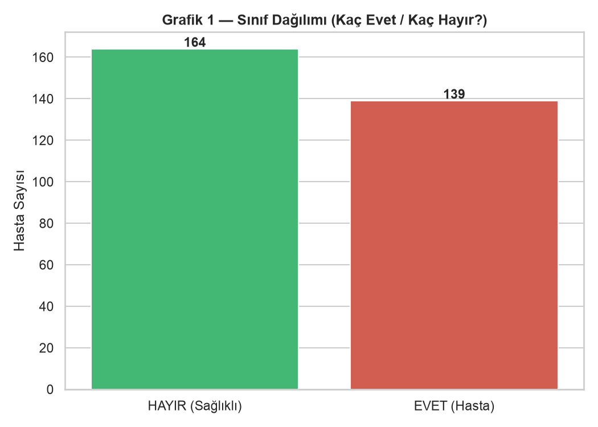
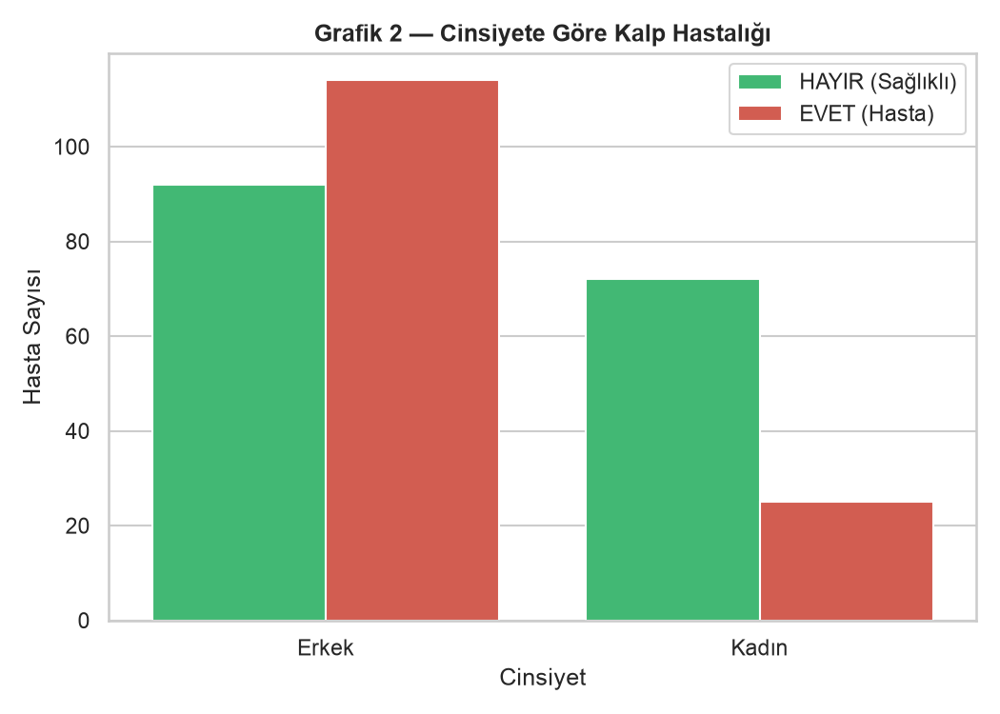
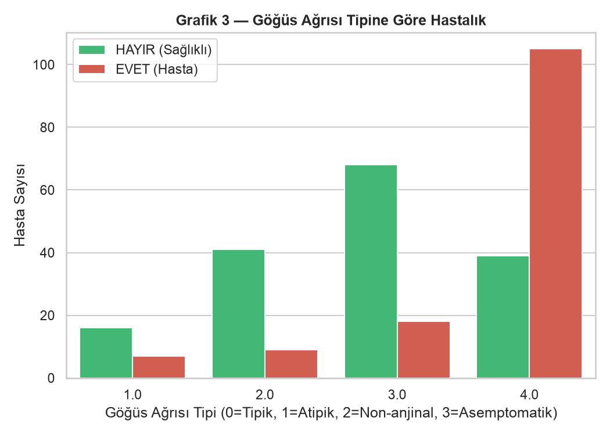
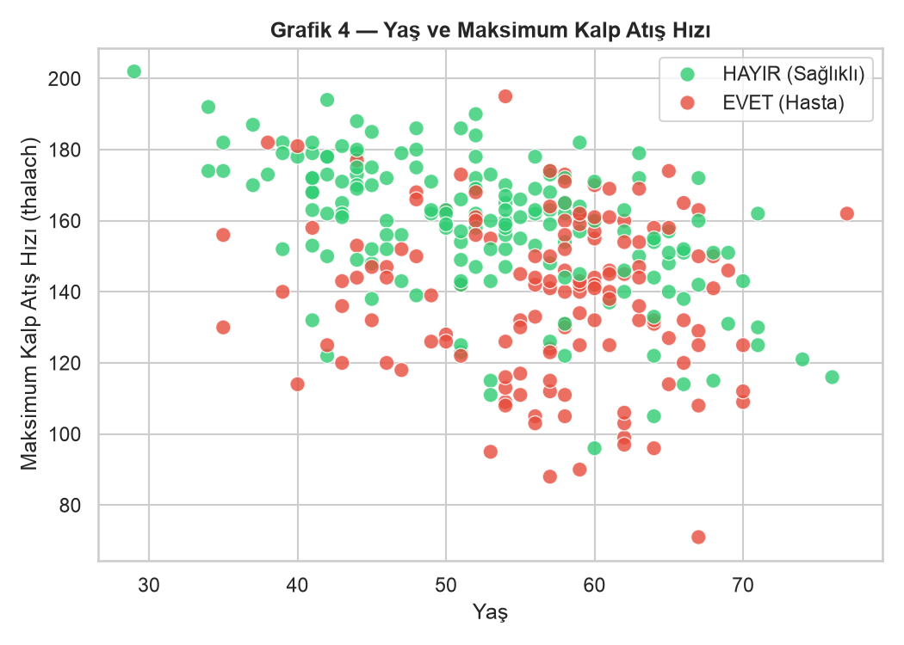
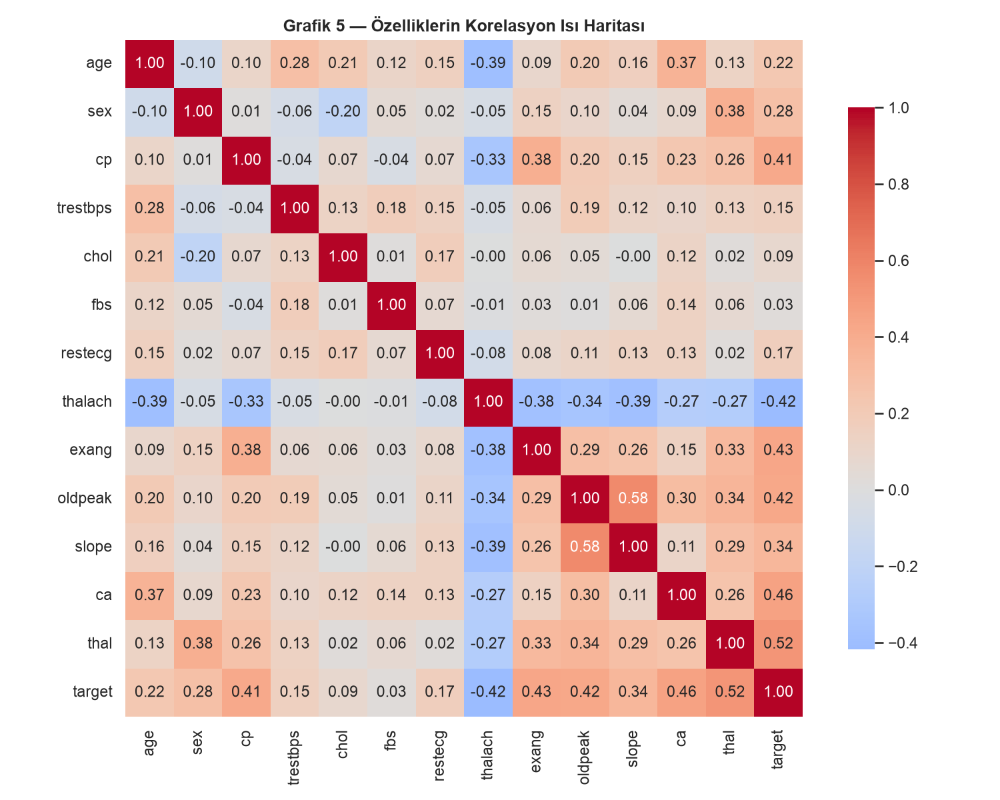
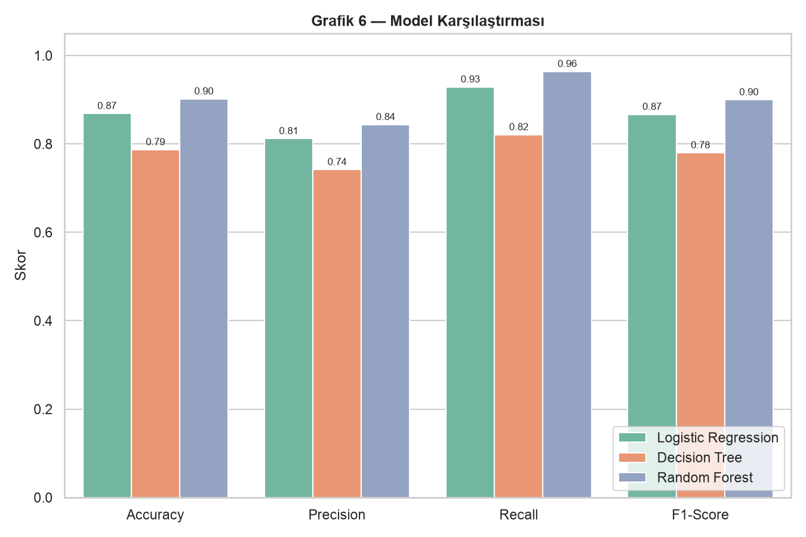
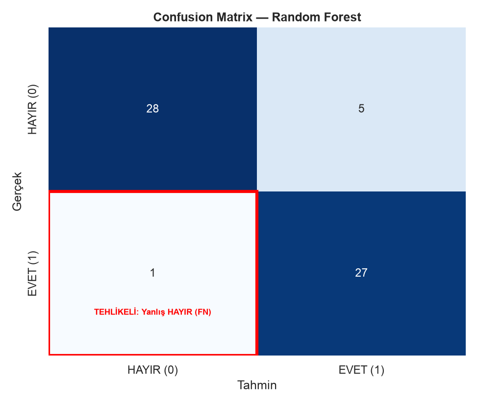

# ❤️ Kalp Hastalığı Tahmini ve Klinik Karar Destek Arayüzü

Bu proje, **Heart Disease UCI (Cleveland)** veri setini kullanarak bir hastanın kalp
hastası olup olmadığını (**Evet mi, Hayır mı?**) tahmin eden bir makine öğrenmesi
sınıflandırma çalışmasıdır. Üç farklı model karşılaştırılır ve tüm sonuçlar modern,
sekmeli bir **Streamlit** arayüzünde jüriye/sunuma hazır biçimde gösterilir.

---

## 📦 Kurulum ve Çalıştırma

```bash
# 1) Sanal ortam oluştur ve kütüphaneleri kur
python3 -m venv .venv
source .venv/bin/activate        # Windows: .venv\Scripts\activate
pip install -r requirements.txt

# 2) Veriyi indir, grafikleri üret ve modeli eğit
python train_and_analyze.py

# 3) Sunum arayüzünü başlat
streamlit run app.py
```

---

## 🗂️ Dosya Düzeni

| Dosya | Açıklama |
|-------|----------|
| `train_and_analyze.py` | Veriyi indirir, temizler, 5 grafiği üretir, 3 modeli eğitip karşılaştırır, hata analizini yapar ve en iyi modeli `model.pkl` olarak kaydeder. |
| `app.py` | 4 sekmeli modern Streamlit arayüzü (teşhis simülatörü + analizler). |
| `requirements.txt` | Gerekli Python kütüphaneleri. |
| `.gitignore` | `__pycache__/`, `.venv/`, `.DS_Store`. |
| `README.md` | Bu dokümantasyon. |
| `data/heart.csv` | Otomatik indirilen veri seti. |
| `plots/` | Üretilen tüm grafikler (PNG). |
| `model.pkl` | Eğitilmiş en iyi model ve analiz çıktıları. |

---

## 🔗 Veri Seti

- **Kaynak (UCI):** https://archive.ics.uci.edu/dataset/45/heart+disease
- **Ham CSV (Cleveland):** https://archive.ics.uci.edu/ml/machine-learning-databases/heart-disease/processed.cleveland.data
- **Kaggle sürümü:** https://www.kaggle.com/datasets/ronitf/heart-disease-uci
- **Boyut:** 303 satır × 14 sütun
- Betik veriyi **otomatik indirir**; internet yoksa güvenli bir yedek (sentetik) veriye düşer.

### Sütun Açıklamaları

| Sütun | Türkçe Karşılığı |
|-------|------------------|
| `age` | Yaş |
| `sex` | Cinsiyet (1 = Erkek, 0 = Kadın) |
| `cp` | Göğüs Ağrısı Tipi (0 = Tipik, 1 = Atipik, 2 = Non-anjinal, 3 = Asemptomatik) |
| `trestbps` | Dinlenme Kan Basıncı (mm Hg) |
| `chol` | Kolesterol (mg/dl) |
| `fbs` | Açlık Kan Şekeri > 120 mg/dl (1 = Evet, 0 = Hayır) |
| `restecg` | Dinlenme EKG Sonucu (0–2) |
| `thalach` | Maksimum Kalp Atış Hızı |
| `exang` | Egzersize Bağlı Anjina (1 = Var, 0 = Yok) |
| `oldpeak` | Egzersize bağlı ST depresyonu |
| `slope` | ST segmentinin eğimi (0–2) |
| `ca` | Floroskopi ile boyanan ana damar sayısı (0–3) |
| `thal` | Talasemi (1 = Normal, 2 = Sabit defekt, 3 = Geri dönüşlü defekt) |
| `target` | **Hedef:** 1 = Kalp Hastalığı VAR (EVET), 0 = YOK (HAYIR) |

### Sınıf Dengesi

| Sınıf | Adet | Oran |
|-------|------|------|
| **EVET** (1 – Kalp Hastası) | 139 | %45.9 |
| **HAYIR** (0 – Sağlıklı) | 164 | %54.1 |

Sınıflar birbirine yakın olduğu için veri seti **dengelidir**; bu, modelin tek bir
sınıfa yanlı olmadan öğrenmesini sağlar.

---

## 🧹 Veri Temizleme

- UCI ham dosyasındaki `?` değerleri `NaN`'a çevrildi.
- `ca` ve `thal` sütunlarındaki **6 eksik değer**, ilgili sütunun **medyanı** ile dolduruldu.
- Hedef değişken `num` (0–4) ikili hale getirildi: `>0` → **1 (hasta)**, `0` → **0 (sağlıklı)**.
- Tüm özellikler modele verilmeden önce **`StandardScaler`** ile ölçeklendirildi.

---

## 📊 5 Grafik ve Yorumları

| | Grafik | Yorum |
|---|--------|-------|
| 1 |  | **Sınıf Dağılımı:** Evet (139) ve Hayır (164) sınıfları dengelidir; model yanlı öğrenmez. |
| 2 |  | **Cinsiyete Göre:** Erkek hastalarda kalp hastalığı sayısı daha yüksektir; cinsiyet anlamlı bir risk faktörüdür. |
| 3 |  | **Göğüs Ağrısı Tipi:** Asemptomatik (tip 0) hastalarda bile hastalık oranı yüksektir — "ağrım yok" riski dışlamaz. |
| 4 |  | **Yaş & Maks. Nabız:** İleri yaş + düşük maksimum nabız, hasta grubunda yoğunlaşır. |
| 5 |  | **Korelasyon:** Hedefle en güçlü ilişkili değişkenler `cp`, `thalach`, `oldpeak`, `exang` ve `ca`'dır. |

---

## 🏆 Model Karşılaştırması

Veri **%80 eğitim / %20 test** olarak ayrıldı (`random_state=42`, `stratify=y`).

| Model | Accuracy | Precision | **Recall** | F1-Score |
|-------|:--------:|:---------:|:----------:|:--------:|
| Logistic Regression | 0.869 | 0.812 | 0.929 | 0.867 |
| Decision Tree | 0.787 | 0.742 | 0.821 | 0.780 |
| **Random Forest** ⭐ | **0.902** | **0.844** | **0.964** | **0.900** |



En iyi model, sağlıkta en kritik metrik olan **Recall**'e göre seçilmiştir:
**Random Forest (Recall = 0.964)**. Yani gerçek hastaların %96.4'ünü doğru yakalar.

### Confusion Matrix (Random Forest)



Kırmızı ile çerçevelenen hücre **False Negative (Yanlış HAYIR)** bölgesidir — en
tehlikeli hata türü budur ve mümkün olduğunca küçük tutulması hedeflenir.

---

## 🚨 Kritik Soru: Yanlış "Hayır" mı Daha Kötü, Yanlış "Evet" mi?

> **Bu problemde yanlış "HAYIR" demek çok daha tehlikelidir.**

| | Yanlış **HAYIR** (False Negative) | Yanlış **EVET** (False Positive) |
|---|---|---|
| **Ne olur?** | Kalp hastasına "sağlıklısın" denir | Sağlıklıya "hastasın" denir |
| **Sonuç** | Tedavi gecikir → **hayati risk, ölüm** | Gereksiz ek test / doktor kontrolü |
| **Maliyet** | 💀 Geri dönüşü olmayabilir | 💰 Zaman ve küçük masraf |

Hastanın hayatı söz konusu olduğu için amacımız **gerçek hastaları kaçırmamaktır**.
Bu nedenle modeli değerlendirirken ve seçerken **Recall (Duyarlılık)** metriğini
önceliklendirdik. Recall yükseldikçe False Negative (yanlış "Hayır") sayısı azalır.

---

## 🔍 Yanlış Tahmin Analizi (Bonus)

Model test setinde toplam **6 hatalı tahmin** yaptı. Örnekler ve otomatik yorumları:

- 🔴 **Yanlış HAYIR (FN – tehlikeli):** 60 yaşında, maks. nabzı 155, göğüs ağrısı tipi 3
  olan hasta. Değerleri "normal"e yakın göründüğü için model "Sağlıklı" dedi, oysa
  hasta gerçekte kalp rahatsızıydı.
- 🟡 **Yanlış EVET (FP):** 66 yaşında, kolesterolü 228, oldpeak değeri 2.3 olan kişi.
  Riskli değerler yüzünden model "Hasta" dedi, oysa kişi sağlıklıydı → sadece
  gereksiz ek kontrol maliyeti.

Arayüzün **"Model Neden Yanıldı?"** sekmesinde bu örnekler tablo ve renkli uyarılarla
(kırmızı = tehlikeli FN, sarı = FP) ayrıntılı sunulur.

---

## 🖥️ Streamlit Arayüzü (4 Sekme)

1. **🩺 Canlı Klinik Teşhis Simülatörü** — Yaş, cinsiyet, göğüs ağrısı, tansiyon,
   kolesterol, maksimum nabız gibi değerleri girin; model **"EVET – Yüksek Risk (%XX)"**
   veya **"HAYIR – Düşük Risk (%XX)"** sonucunu büyük renkli bir kartta gösterir.
2. **📊 Veri Analizi & 5 Grafik** — Veri özeti, sınıf dağılımı ve 5 grafik, her birinin
   altında Türkçe yorumuyla.
3. **🏆 Model Karşılaştırması** — 3 modelin metrik tablosu, karşılaştırma grafiği,
   confusion matrix ve "Neden yanlış HAYIR daha kötü?" vurgu kutusu.
4. **🔍 Model Neden Yanıldı?** — Yanlış tahmin edilen gerçek hasta örnekleri ve
   neden-sonuç yorumları.

---

## 🛠️ Kullanılan Teknolojiler

`Python` · `pandas` · `numpy` · `matplotlib` · `seaborn` · `scikit-learn` ·
`streamlit` · `joblib`
